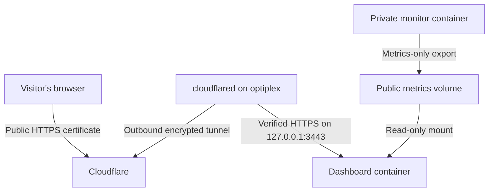

# Bring the Optiplex dashboard online

This guide is for the existing **optiplex** Coolify resource on the **optiplex home
server**, not the VPS. The public address is:

**https://dashboard.davevancauwenberghe.be**

The stack uses the existing Node runtime, two containers and a host-installed
Cloudflare Tunnel connector. **No Apache or PHP-FPM is needed.** Keep the existing
SSH/Tailscale rules, router configuration and private `history-data` volume.

## What becomes public

- Latest host CPU usage, memory, swap, load averages, host/bot uptime and coretemp readings.
- Retained CPU/memory/hottest-temperature averages, minima and maxima, with 96
  time buckets for 1h, 6h, 24h, 7d, 30d, 365d and all recorded time.
- Hardware details already displayed in the page and the monitor version.

No command records, Discord IDs, usernames, guild/channel IDs, addresses, tokens,
logs or filesystem browser are exposed. The public container has neither the
private SQLite volume nor the bot's environment variables or dependencies.
It mounts a **separate metrics-only volume read-only**. Public HTTP requests read
cached exports, never trigger SQLite queries or take a new sensor reading.

The bot updates live readings about every minute. History is exported every five
minutes by the read-only query worker with its existing 10-second deadline. The
browser polls every 30 seconds while visible. Empty chart periods remain gaps;
readings older than three minutes are marked stale. Past versions did not retain
swap, load or individual core history, so those remain live-only. Stale data is
not proof of a host outage: a bot, Discord, connection or export failure can cause it.

The app adds no cookies, analytics, accounts or local storage. Cloudflare still
processes connection data to deliver the site. Search indexing is discouraged;
this is not access control. The dashboard and its metric API are public, read-only.

## The route and certificates



Cloudflare's **edge certificate** is trusted by browsers. A separate **Origin CA
certificate** covers the local HTTPS hop from `cloudflared` to the dashboard.
Origin CA certificates are not browser-trusted. Keep certificate verification on;
do not use `curl -k`, Flexible mode or the tunnel's Disable TLS verification option.
The domain SSL mode does not replace the tunnel's origin TLS settings.

Only port **3443 on loopback** is published. Keep Coolify's dashboard Domains field
empty and its public proxy stopped on optiplex. Do not add A/AAAA records pointing
to your home/Tailscale IP or open router/UFW ports 80, 443 or 3443.

## 1. Before upgrading

1. Wait for the v0.3.0 PR to be reviewed and merged. Avoid letting an automatic
   deployment run before steps 2–3 below are ready.
2. In the **existing bot container terminal**, run `npm run backup`. Keep an
   external backup too; see [BACKUPS.md](BACKUPS.md).
3. In Coolify, note the existing persistent `history-data` volume. Upgrade the
   **same resource**; do not create a replacement resource with a fresh archive,
   rename the volume or run `docker compose down -v`.
4. SSH into **optiplex** as `dave`, and check:

```bash
hostname
id -u dave
sudo ss -lntp 'sport = :3443'
```

Expect hostname `optiplex`, UID `1000`, and no existing listener on 3443. The image's
`node` user is UID/GID 1000. Certificate permissions below grant read access to
container GID 1000; if your host's `dave` UID differs, keep the numeric container GID.

## 2. Create the origin private key on optiplex

Run on **optiplex**. The private key stays there; only the public CSR goes to Cloudflare.
These commands create new files. If `origin.key` already exists, keep it and review
it rather than generating over it.

```bash
sudo install -d -o root -g 1000 -m 0750 /etc/optiplex-dashboard/tls
sudo test ! -e /etc/optiplex-dashboard/tls/origin.key && \
  sudo openssl req -new -newkey rsa:2048 -nodes \
    -keyout /etc/optiplex-dashboard/tls/origin.key \
    -out /etc/optiplex-dashboard/tls/origin.csr \
    -subj '/CN=dashboard.davevancauwenberghe.be' \
    -addext 'subjectAltName=DNS:dashboard.davevancauwenberghe.be'
sudo chown root:1000 /etc/optiplex-dashboard/tls/origin.key
sudo chmod 0640 /etc/optiplex-dashboard/tls/origin.key
sudo cat /etc/optiplex-dashboard/tls/origin.csr
```

The CSR text (`BEGIN CERTIFICATE REQUEST`) is safe to copy. **Never copy the private
key into GitHub, chat, a Docker build context or a public certificate checker.**

## 3. Issue and install the Origin CA certificate

In Cloudflare, select **davevancauwenberghe.be → SSL/TLS → Origin Server → Create
Certificate**:

1. Choose **Use my private key and CSR** and paste the CSR from step 2.
2. Protect only `dashboard.davevancauwenberghe.be`; remove unnecessary wildcard/apex names.
3. Choose a validity period (for example **one year**) and create the certificate.
4. Copy the **PEM Origin Certificate** into the file below. It is a certificate,
   not your private key:

```bash
sudo nano /etc/optiplex-dashboard/tls/origin.pem
```

Save with Ctrl+O, Enter, then exit with Ctrl+X. Download the two public Origin CA
roots from Cloudflare, combine them, and set permissions:

```bash
curl --fail --silent --show-error \
  https://developers.cloudflare.com/ssl/static/origin_ca_rsa_root.pem \
  -o /tmp/optiplex-origin-rsa.pem
curl --fail --silent --show-error \
  https://developers.cloudflare.com/ssl/static/origin_ca_ecc_root.pem \
  -o /tmp/optiplex-origin-ecc.pem
cat /tmp/optiplex-origin-rsa.pem /tmp/optiplex-origin-ecc.pem | \
  sudo tee /etc/optiplex-dashboard/tls/origin-ca.pem > /dev/null
sudo chown root:1000 /etc/optiplex-dashboard/tls/origin.pem \
  /etc/optiplex-dashboard/tls/origin-ca.pem
sudo chmod 0640 /etc/optiplex-dashboard/tls/origin.pem \
  /etc/optiplex-dashboard/tls/origin-ca.pem
sudo openssl verify \
  -CAfile /etc/optiplex-dashboard/tls/origin-ca.pem \
  -verify_hostname dashboard.davevancauwenberghe.be \
  /etc/optiplex-dashboard/tls/origin.pem
sudo openssl x509 -in /etc/optiplex-dashboard/tls/origin.pem -noout -dates -subject
```

The verification must say `OK`. Record the expiry date; Origin CA certificates do
not renew automatically or receive Cloudflare expiry notifications. Before expiry,
issue a replacement certificate, update these files, then restart the dashboard.

## 4. Upgrade the existing Coolify resource

After steps 2–3 and merging the release:

1. Open the **existing Optiplex Docker Compose application** on the `optiplex` server.
2. Keep its existing source/branch, Compose location (`/compose.yaml`), Discord
   secrets, public IDs, admin ID and retention settings. Reload the Compose definition.
3. Add these **runtime** variables. Do not mark them build-time:

| Variable | Value |
| --- | --- |
| `DASHBOARD_PUBLIC_URL` | `https://dashboard.davevancauwenberghe.be` |
| `DASHBOARD_TLS_HOST_PATH` | `/etc/optiplex-dashboard/tls` |

4. Keep **Domains empty for both services**. Do not request a Let's Encrypt
   certificate or route through Coolify's public Traefik proxy. Do not enable
   **Connect To Predefined Network** for this stack.
5. Deploy. `optiplex` keeps its private archive and gains a writable `public-metrics`
   volume. `dashboard` mounts only that public volume and the certificate directory
   read-only. It has a 128 MiB RAM / 0.25 CPU cap; the bot's limits remain unchanged.
6. Check the bot and dashboard containers are running. The bot should publish its
   first live export after Discord connects. A history export can follow shortly after.

On **optiplex** verify the origin, trusting your Origin CA root and checking the
real hostname even though the network connection uses loopback:

```bash
sudo curl --fail --silent --show-error \
  --cacert /etc/optiplex-dashboard/tls/origin-ca.pem \
  --resolve dashboard.davevancauwenberghe.be:3443:127.0.0.1 \
  https://dashboard.davevancauwenberghe.be:3443/healthz
sudo curl --fail --silent --show-error \
  --cacert /etc/optiplex-dashboard/tls/origin-ca.pem \
  --resolve dashboard.davevancauwenberghe.be:3443:127.0.0.1 \
  https://dashboard.davevancauwenberghe.be:3443/api/metrics
sudo ss -lntp 'sport = :3443'
```

`healthz` returns `{"ok":true}`; it checks the web process, not host freshness.
The API should show `status.state: "live"`. A 503 means no validated live export is
available yet. The port binding must be `127.0.0.1`, never `0.0.0.0` or `[::]`.
Docker can implement port publishing without a socket visible to `ss`; confirm the
binding in `docker ps`/`docker inspect` as well. Do not publish the archive files.

## 5. Install the Cloudflare connector on optiplex

Use a **host-installed** connector for this guide. In a connector container,
`127.0.0.1` would mean that other container, not the host. If you already run a host
connector for other apps, retain it and add this route instead of replacing its service.
The steps below create a dedicated service, without touching any existing connector.

```bash
sudo install -d -m 0755 /usr/share/keyrings
curl --fail --silent --show-error https://pkg.cloudflare.com/cloudflare-main.gpg | \
  sudo tee /usr/share/keyrings/cloudflare-main.gpg > /dev/null
printf '%s\n' 'deb [signed-by=/usr/share/keyrings/cloudflare-main.gpg] https://pkg.cloudflare.com/cloudflared any main' | \
  sudo tee /etc/apt/sources.list.d/cloudflared.list > /dev/null
sudo apt update
sudo apt install cloudflared
cloudflared --version
```

The `any` repository avoids relying on a distribution codename. This third-party
package is not automatically covered by Ubuntu's security-only unattended-upgrade
origins; include it in your routine `sudo apt update && sudo apt upgrade` maintenance.

## 6. Create a tunnel and keep its token private

In Cloudflare, open **Networking → Tunnels → Create tunnel** (some accounts show
**Zero Trust → Networks → Connectors → Cloudflare Tunnels**). Select Cloudflared
if asked and name it **optiplex-dashboard**.

Copy **only the tunnel token** from the shown installation command. Do not paste
the whole command into the file, and do not share the token. In the optiplex SSH shell:

```bash
sudo install -d -o root -g root -m 0700 /etc/optiplex-dashboard/tunnel
sudo test -e /etc/optiplex-dashboard/tunnel/token || \
  sudo install -m 0600 /dev/null /etc/optiplex-dashboard/tunnel/token
sudo nano /etc/optiplex-dashboard/tunnel/token
```

Paste the token as one line, save and exit. It stays in a root-only file and out of
shell history, process arguments and the bot's environment. A tunnel token can
start a connector for that tunnel; rotate it in Cloudflare if disclosed.

Create a dedicated unprivileged account and a public CA copy for the connector:

```bash
id -u optiplex-tunnel >/dev/null 2>&1 || \
  sudo useradd --system --user-group --no-create-home \
    --home-dir /nonexistent --shell /usr/sbin/nologin optiplex-tunnel
sudo install -d -o root -g root -m 0755 /etc/optiplex-dashboard/connector
sudo install -o root -g root -m 0644 \
  /etc/optiplex-dashboard/tls/origin-ca.pem \
  /etc/optiplex-dashboard/connector/origin-ca.pem
```

Install the service. `LoadCredential` passes the token privately to the service;
`%d` expands to its runtime credential directory. The connector has no access to the
Origin private key or bot database. This unit supports HTTP(S) tunnelling, not ICMP:

```bash
sudo tee /etc/systemd/system/optiplex-dashboard-tunnel.service > /dev/null <<'UNIT'
[Unit]
Description=Optiplex dashboard Cloudflare Tunnel
After=network-online.target
Wants=network-online.target

[Service]
Type=simple
User=optiplex-tunnel
Group=optiplex-tunnel
LoadCredential=tunnel-token:/etc/optiplex-dashboard/tunnel/token
ExecStart=/usr/bin/cloudflared tunnel --no-autoupdate --metrics 127.0.0.1:20242 run --token-file %d/tunnel-token
Restart=on-failure
RestartSec=5s
TimeoutStopSec=30s
NoNewPrivileges=true
PrivateTmp=true
ProtectSystem=strict
ProtectHome=true
ProtectKernelTunables=true
ProtectKernelModules=true
ProtectControlGroups=true
RestrictSUIDSGID=true
UMask=0077

[Install]
WantedBy=multi-user.target
UNIT
sudo systemctl daemon-reload
sudo systemctl enable --now optiplex-dashboard-tunnel.service
sudo systemctl is-active optiplex-dashboard-tunnel.service
sudo journalctl -u optiplex-dashboard-tunnel.service -n 30 --no-pager
```

Wait for Cloudflare to show **Healthy/Connected**. The metrics port 20242 is loopback
only; if another local service uses it, choose another unused loopback port in the unit.
The usual unprivileged ICMP warning can be ignored for this HTTP(S)-only tunnel.

## 7. Add the published hostname and origin TLS settings

In your tunnel, add a **Published application / Public hostname** route:

| Setting | Value |
| --- | --- |
| Subdomain | `dashboard` |
| Domain | `davevancauwenberghe.be` |
| Path | Leave empty |
| Service type | `HTTPS` |
| Service URL | `127.0.0.1:3443` |
| Origin Server Name (TLS settings) | `dashboard.davevancauwenberghe.be` |
| CA Pool (TLS settings) | `/etc/optiplex-dashboard/connector/origin-ca.pem` |
| Disable TLS certificate verification / No TLS Verify | **Off** |
| HTTP/2 to origin | **Off** (Node serves HTTPS with HTTP/1.1) |

If there is one Service URL field instead of separate type/address controls, use
`https://127.0.0.1:3443`. The CA Pool path is on the **connector host**, not the
container path `/app/tls`. Save the route. No wildcard/private-network route is needed.

## 8. Verify the Cloudflare DNS record and public HTTPS

A published route normally creates the DNS record automatically. In the zone's
**DNS → Records**, check:

| Type | Name | Target | Proxy |
| --- | --- | --- | --- |
| CNAME | `dashboard` | `<YOUR_TUNNEL_UUID>.cfargotunnel.com` | Proxied (orange cloud) |

Use the tunnel's actual UUID from its details page. If the record was not created,
add it manually. If `dashboard` already has an unrelated A/AAAA/CNAME, review/remove
that one conflicting name before adding this record; leave other records alone.
Do not use your changing home IP, a 100.x Tailscale IP or the VPS IP as the target.
Cloudflare can flatten proxied CNAMEs in DNS answers, so `dig` may return edge A/AAAA
addresses rather than displaying the literal CNAME. Check the record in the UI.

In **SSL/TLS → Edge Certificates**, verify Universal SSL covers the hostname. Use
**Full (strict)** for the zone if its other origins support it, or scope the setting
to this hostname. Do not change unrelated origins' encryption settings. The tunnel's
Service URL, Origin Server Name and CA Pool are still required independently.
Ensure HTTP requests redirect to HTTPS (Always Use HTTPS or a hostname-specific
Redirect Rule). A one-level `dashboard` name is normally covered by the zone's
standard edge certificate.

If you have a broad Cache Everything rule, add a higher-priority bypass rule for
`dashboard.davevancauwenberghe.be/api/*` and `/healthz`; respect the app's `no-store`
headers. Avoid interactive bot challenges on the public page/preview image if you
want Discord/social crawlers to fetch the preview. Do not disable zone-wide protection.

From your Mac or another external device, using the normal trusted browser/curl:

```bash
curl --fail --silent --show-error --head https://dashboard.davevancauwenberghe.be/
curl --fail --silent --show-error https://dashboard.davevancauwenberghe.be/api/metrics
curl --fail --silent --show-error --head https://dashboard.davevancauwenberghe.be/assets/preview.png
```

Open the site on Wi-Fi and mobile data. Check a fresh timestamp, the 1h/24h/all-time
buttons, Temperature view, and Privacy dialog. Share its URL in Discord: the branded
1200×630 PNG preview contains no live values or user data. Discord caches link previews,
so an older preview may take time to refresh. No new Discord permissions/intents are needed.

## 9. Keep it healthy

- Keep Tailscale and key-only SSH for administration; the site has no admin endpoints.
- Continue bot archive backups and OS/package updates. The public export is derived
  data and can be regenerated; it needs no separate backup and has no audit records.
- Check certificate expiry with the command in step 3. Replace the certificate and
  restart the dashboard before it expires. If the trusted CA changes, replace the
  connector's public CA copy and restart its service too.
- If you stop the monitor, the independent web container can still show the last
  readings as **stale**. If the whole host or tunnel dies, the site is unreachable.
  External uptime monitoring is needed to detect that from elsewhere.
- Docker health marks are not automatic hung-process recovery. The bot's existing
  external heartbeat remains useful; this release adds no Docker socket/autoheal.
- To take only the site offline, disable this published route or stop
  `optiplex-dashboard-tunnel.service`. Keep the bot and its private volume.

## Troubleshooting

| Symptom | Check |
| --- | --- |
| Dashboard build/start fails | Origin files exist before deployment; GID 1000 can read the directory/key/cert; `DASHBOARD_PUBLIC_URL` is set; resource builds the `dashboard` target. |
| HTTPS origin check fails | PEM certificate matches private key, correct hostname, valid dates, both public roots installed. Do not bypass verification. |
| Tunnel Healthy but public 502 | Run the local curl test first; host connector uses `https://127.0.0.1:3443`, correct SNI and host CA Pool path. |
| Tunnel unavailable/1033 | Service token and connector logs; outbound TCP/UDP 7844 permitted. No inbound router rule is needed. |
| API 503 / waiting for data | Bot connected to Discord, `dashboard_export_failed` log absent, both services mount the same new `public-metrics` volume, private archive stays on its old volume. |
| Live readings fresh, history stale | Check `dashboard_export_failed`; history query retries after five minutes and keeps the prior export. |
| Site works but no social preview | Edge protection permits crawlers; PNG reachable over public HTTPS; title/image metadata present without JavaScript; Discord cache. |
| Certificate renewal not visible | Restart the dashboard after replacing PEM/key; it loads them at startup. |

## Local development and visual QA

Run `npm run build && npm run dev` for a clearly labelled **sample-data-only** local
preview on port 3000. Open `/__preview?width=390` for a phone-width frame,
or use its 320/768-pixel controls for responsive QA. It does not log in to Discord, read the real archive, send
notifications or need tokens. Never run the preview command in production.
`npm run dashboard` starts the real server; without the TLS variables it uses HTTP
for local development. Compose always supplies all TLS paths and fails if invalid.
The dashboard image intentionally contains neither the preview script nor Discord dependencies.

## Primary references

- [Cloudflare Tunnel setup](https://developers.cloudflare.com/cloudflare-one/networks/connectors/cloudflare-tunnel/get-started/create-remote-tunnel/)
- [Cloudflare origin parameters: SNI and CA Pool](https://developers.cloudflare.com/cloudflare-one/networks/connectors/cloudflare-tunnel/configure-tunnels/origin-parameters/)
- [Origin CA certificates and public roots](https://developers.cloudflare.com/ssl/origin-configuration/origin-ca/)
- [Token-file option](https://developers.cloudflare.com/cloudflare-one/networks/connectors/cloudflare-tunnel/configure-tunnels/run-parameters/#token-file)
- [Official cloudflared APT repository](https://pkg.cloudflare.com/)
- [Coolify Compose networking](https://coolify.io/docs/services/configuration/networking)
